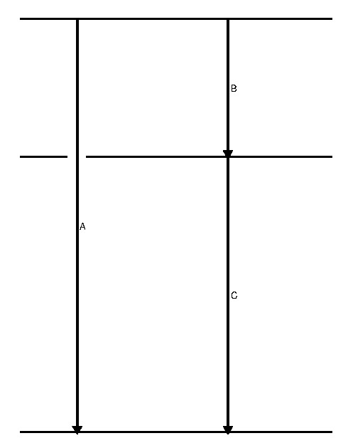

# Principle of summing corrections

When determining photo peak efficiencies, i.e. the probability to detect the full energy of a single $\gamma$ ray, we need to make corrections to account for the fact that none of the radioactive sources we use for the efficiency calibration emit single $\gamma$ rays.
There are two effect that we have to account for, "summing in" and "summing out"



In a case like the one shown here, we have to consider "summing in" for $\gamma$-ray A, events where both $\gamma$-ray B and C are detected with their full energies in a single detector and thus summed together to the same energy as $\gamma$-ray C.
These events artificially increase the number of counts we get in the photo peak of $\gamma$-ray A, leading to a too large efficiency.

We also have to consider "summing out" for $\gamma$-rays B and C to account for instances where $\gamma$-ray B was detected with full energy in a detector, but the same detector also got hit by $\gamma$-ray C and detected at least part of its energy, and vice versa.
In those cases the two energies add together moving the total energy of that event out of the peak for $\gamma$-ray B or C, despite detecting the full energy of those $\gamma$ rays.

In principle both "summing in" and "summing out" corrections can be calculated if the level scheme is well known (which it should be for all standard efficiency calibration sources).
For "summing out" this would involve calculating the probability of an other $\gamma$ ray being in coincidence with the $\gamma$ ray of interest, and the probability of such a coincident $\gamma$ ray then being detected in the same crystal.
The latter involves integrating the angular distribution of the two $\gamma$ rays in question over the solid angle covered by the detector, accounting for the fact that the solid angle a single GRIFFIN (or TIGRESS) crystal covers is not constant over the whole depth of the detector.

Due to the symmetries of GRIFFIN and TIGRESS, we can take advantage of the fact that (at least in the standard setup) each crystal has another crystal at 180&deg; opposite.
Since all angular correlations are symmetric around 90&deg;, the probability for a coincident $\gamma$ ray to hit the same crystal is the same as the probability to hit a crystal of the ==exact same size== 180&deg; opposite.
This allows us to experimentally determine the likelihood of detecting another $\gamma$ ray in coincidence with the $\gamma$ ray of interest in a crystal/detector 180&deg; opposite.

It should be noted that apart from the afore mentioned symmetries of GRIFFIN and TIGRESS, the fact that all crystals are of comparable size is important for this method to work.

## Summing corrections helper

The summing corrections helper creates special histograms to determine the summing in and summing out for all five different ways to use the data:
- unsuppressed crystals,
- suppressed crystals,
- unsuppressed addback,
- suppressed addback, and
- suppressed single crystals with a condition that no other crystal in the same detector was hit.

A file with user values can be used to
- disable pile-up rejection or provide a k-value (default: enabled, k-value 379),
- set a maximum CFD value above which hits get rejected (default: 20 ns),
- set a minimum energy for GRIFFIN hits to be accepted (default: 0 keV),
- change the timing condition (default: -250 - 250 ns), and
- set the energy range of the histograms and their binning (1D- and 2D-binning separately, default: 10000 1D-bins and 2000 2D-bins from 0 to 2000 keV).

If the user file contains prompt and time-random timing conditions as well as energy gating conditions, the matrices produced will be gated on a specific $\gamma$ ray with time-random subtraction, and Compton subtraction (if energy background ranges are provided).
These can be used for summing corrections for branching ratios (see [Summing corrections for branching ratios](#summing-corrections-for-branching-ratios)).

More detailed descriptions can be found below.

## Summing in

For summing in we want to consider all possible combinations of two $\gamma$ rays whose energies add up to the energy in question.
So for this we create matrices with the energy of one crystal or detector versus the sum of it with the crystal or detector opposite of it.
This means for all five ways of looking at $\gamma$ ray data we do a double loop with exactly the same conditions on both hits, and if they are in coincidence with each other and at an angle of more than 179&deg; or 157&deg; (for singles or addback, respectively), we plot the sum of their energies on the x-axis and the energy of the first hit on the y-axis.

### Using the created spectra

All matrices (```griffinGriffinESum```, ```griffinGriffinESuppSum```, ```griffinGriffinEAddbackSum```, ```griffinGriffinESuppAddbackSum```, or ```griffinGriffinESingleCrystalSum```) have the sum on the x-axis (corresponding to the $\gamma$ ray of interest), and the energy of the opposite crystal/detector on the y-axis.
To check how often we have $\gamma$ rays adding up to the same energy as the $\gamma$ ray of interest, we can use TBGSubtraction on the matrix (with the y-axis selected!), cut on the $\gamma$ ray of interest (with subtraction of Compton background), and then add the integrals of all peaks together (taking care that these are real peaks and not Compton subtraction artifacts!).

Alternatively one can use the ```TEfficiencyCalibrator``` class (still under construction).

## Summing out

For summing out we have to consider all the ways we can miss a $\gamma$ ray despite having detected its full energy.
The way this is done is different for the five different ways to look at $\gamma$ ray data.

One thing that is common to all is that we have a condition that the two $\gamma$ rays are in coincidence, but we do not do any time random correction.
This is because we are looking at single crystal/detector responses to determine our efficiency (we use a 1D histogram to fit all peaks and compare their areas to the expected areas).

We are always applying pile up rejection, minimum energy condition, and CFD condition if these are provided.

### Unsuppressed crystals or addback

For unsuppressed crystals, we simply create a matrix of crystals whose angles to each other are larger than 179&deg;.

For unsuppressed addback, we also need to consider hits in any other crystal of the detector opposite the detector the first hit belongs to, and so we need to accept any two hits with an opening angle larger than 157&deg; instead of 179&deg;.

### Suppressed crystals or addback

For suppressed data, we also need to include hits in the opposite crystal/detector that would have been suppressed.
Because these represent the probability of a second $\gamma$ ray hitting the same crystal/detector that already detected the first $\gamma$ ray with it's full energy and the second $\gamma$ ray being scattered into a BGO.
This would cause that fully detected first $\gamma$ ray to be missed as well, so for these two types of data we create "mixed" matrices, with suppressed single or addback hits on one axis and unsuppressed hits in the opposite crystal/detector on the other axis.
As for the unsuppressed matrices, the angle condition is either larger than 179&deg; or 157&deg;, for crystals and addback respectively.

### Suppressed single crystals without other crystals in the same detector

In this case a hit in any of the other crystals of the same detector would cause us to loose this event, so we need to look at the whole detector opposite the current one.
In the helper the condition of a single (Compton suppressed) crystal in a detector firing is implemented by looking at addback events where the number of "fragments" (i.e. crystals) is one (using ```TGriffin::GetNSuppressedAddbackFrags(index)```).
So the matrix constructed in this case plots suppressed addback hits with a single crystal on one axis, and unsuppressed addback hits (without a condition on the number of crystals involved) that are at an angle of more than 157&deg; on the other axis.

### Using the created spectra

All matrices (```griffinGriffinE```, ```griffinGriffinEMixed```, ```griffinGriffinEAddback```, ```griffinGriffinEMixedAddback```, or ```griffinGriffinEMixedSingleCrystal```) have the $\gamma$ ray of interest on the x-axis, and the other $\gamma$ ray on the y-axis.
To check how often we miss the $\gamma$ ray of interest, you can use ```TBGSubtraction``` on the matrix (with the the y-axis selected!), cut on the $\gamma$ ray of interest (with subtraction of Compton background), and then check the integral of the projection (either by right-clicking the statistics panel and using ```SetOptStat```, or by using the logon-script).

Alternatively one can use the ```TEfficiencyCalibrator``` class (still under construction).

## Summing corrections for branching ratios

When determining branching ratios we normally gate on another $\gamma$ ray to clean up the spectrum and be able to clearly see (and fit) smaller peaks.
This means we want to determine the probability for a second $\gamma$ ray to hit the same crystal/detector while gating on a third $\gamma$ ray.
The gating conditions (timing, energy, and background subtractions) used are the same for both $\gamma$ rays and are the same that were used to determine the branching ratios in the first place.


